# GachaQuest Tutor

Tutor web interaktif untuk tim UAS Dasar Pemrograman yang mengerjakan game GachaQuest. Setiap anggota memilih kartu `P1` sampai `P5`, mengikuti journey kerja per fase, membaca perintah yang bisa disalin, memverifikasi expected result lewat screenshot, dan menandai milestone yang sudah selesai. Progres tersimpan di browser tanpa backend.

## Daftar isi

- [Features](#features)
- [Requirements](#requirements)
- [Install](#install)
- [Usage](#usage)
- [Reading the fields](#reading-the-fields)
- [What it reads / touches](#what-it-reads--touches)
- [Architecture](#architecture)
- [Development](#development)
- [Deployment](#deployment)
- [Troubleshooting](#troubleshooting)
- [Security notes](#security-notes)
- [License](#license)

## Features

- Picker lima anggota: `P1`, `P2`, `P3`, `P4`, `P5` dengan peran, level, branch, file milik, dan target layar.
- Journey tiga kolom di desktop: timeline milestone, detail langkah, dan konteks anggota.
- Detail langkah memuat materi kuliah terkait, langkah kerja, perintah siap salin, expected result, dan screenshot target.
- Progres per anggota tersimpan di `localStorage`; langkah berikutnya terkunci sampai langkah sekarang ditandai selesai.
- Ganti nama per anggota dan reset progres dengan dialog konfirmasi.
- Tema terang dan gelap, tersimpan antar sesi.
- Lightbox untuk 18 screenshot target dan diagram alur fase.
- Layout mobile memakai drawer modal untuk timeline dan konteks anggota.
- Shortcut `1` sampai `5` memilih anggota, `Esc` kembali ke picker.

## Requirements

- Bun 1.3 atau lebih baru.
- Git.
- Browser modern dengan dukungan `color-scheme` dan `View Transitions`.
- Tidak ada database, API key, atau server backend.

## Install

1. Clone repo.

   ```bash
   git clone https://github.com/yayayapluto/gachaquest-tutor.git
   cd gachaquest-tutor
   ```

2. Install dependency.

   ```bash
   bun install
   ```

3. Jalankan dev server.

   ```bash
   bun run dev
   ```

4. **Verify it loaded.** Buka `http://localhost:5183/`. Halaman harus menampilkan judul `GachaQuest: Tutor Tim`, lima kartu anggota, dan teks `Pilih anggota, ikuti journey, buktikan hasil.`.

## Usage

Pilih kartu anggota untuk masuk journey. Nama default anggota sama dengan kodenya, misalnya `P1`. Untuk mengganti nama, buka journey lalu klik `Ganti nama`.

| Aksi                               | Efek                                                                   |
| ---------------------------------- | ---------------------------------------------------------------------- |
| Klik kartu anggota                 | Masuk journey anggota tersebut.                                        |
| Tekan `1` sampai `5` di picker     | Memilih anggota sesuai urutan.                                         |
| Klik milestone di timeline         | Membuka detail langkah di panel tengah.                                |
| Klik `Salin` pada blok perintah    | Menyalin perintah ke clipboard.                                        |
| Klik `Tandai selesai`              | Menandai langkah aktif sebagai selesai dan membuka langkah berikutnya. |
| Klik `Ganti nama`                  | Mengubah nama sapaan tanpa menghapus progres.                          |
| Klik `Aksi lain` → `Reset progres` | Menghapus centang milestone anggota aktif setelah konfirmasi.          |
| Klik `Pilih anggota`               | Kembali ke layar picker.                                               |
| Klik thumbnail screenshot          | Membuka lightbox dengan navigasi panah.                                |
| Klik ikon tema                     | Berganti tema terang dan gelap.                                        |

Contoh sesi kerja:

```text
1. Tekan 1            -> journey P1
2. Klik "Periksa .gitignore"
3. Klik Salin pada "git switch -c feat/scaffold-ui"
4. Klik Tandai selesai -> "Langkah 2 dari 18"
```

## Reading the fields

| Field               | Arti                                                            |
| ------------------- | --------------------------------------------------------------- |
| `F0` sampai `F4`    | Fase kerja: contract, UI siap, modul paralel, integrasi, rilis. |
| `Langkah N dari M`  | Posisi langkah aktif di journey anggota.                        |
| `Progres P1`        | Jumlah milestone selesai dibanding total milestone anggota.     |
| `Target N layar`    | Jumlah screenshot expected result yang relevan untuk anggota.   |
| `Belum selesai`     | Status langkah yang belum ditandai selesai.                     |
| `Tema terang/gelap` | Mode tampilan aktif.                                            |

## What it reads / touches

| Sumber atau target                    | Tujuan                                                                  |
| ------------------------------------- | ----------------------------------------------------------------------- |
| `src/data/journey.js`                 | Data anggota, fase, langkah, perintah, expected result, dan screenshot. |
| `public/assets/screens/*.png`         | 18 screenshot expected result.                                          |
| `public/assets/journey-flow-*.svg`    | Diagram alur fase per tema.                                             |
| `localStorage["gachaquest-tutor-v1"]` | Tema, nama per anggota, dan progres.                                    |
| Clipboard                             | Tombol `Salin` menyalin perintah kerja.                                 |

Tidak ada fetch ke server, tidak ada cookie, dan tidak ada telemetry.

Struktur `localStorage`:

```json
{
  "theme": "light",
  "names": { "P1": "Farros" },
  "done": { "P1": ["f0-1", "f0-2"] }
}
```

## Architecture

```text
Web-Tutor-GachaQuest/
  index.html
  vite.config.js
  src/
    main.jsx
    App.jsx
    app.css
    icons.jsx
    data/journey.js
  public/
    _headers
    assets/screens/*.png
    assets/journey-flow-{light,dark}.svg
  docs/
    journey-flow.mmd
    build-flow.mjs
    deploy-cloudflare.md
  scripts/smoke.mjs
```



Alur data:

```text
localStorage -> store React -> picker/journey/detail
input user -> store -> localStorage
data journey -> timeline, detail, chart, thumbnail
```

## Development

| Perintah          | Efek                                                                       |
| ----------------- | -------------------------------------------------------------------------- |
| `bun run dev`     | Dev server Vite di `http://localhost:5183/`.                               |
| `bun run build`   | Build produksi ke `dist/`.                                                 |
| `bun run preview` | Preview build di `http://localhost:5184/`.                                 |
| `bun run check`   | Biome check plus perbaikan otomatis.                                       |
| `bun run lint`    | Biome check tanpa perubahan berkas.                                        |
| `bun run format`  | Format semua berkas dengan Biome.                                          |
| `bun run smoke`   | Build lalu verifikasi 51 langkah, 18 screenshot, dan 2 diagram di `dist/`. |
| `bun run diagram` | Render `docs/journey-flow.mmd` ke SVG terang dan gelap.                    |

Pre-commit hook menjalankan `bun run smoke`, jadi commit gagal bila build atau aset tidak lengkap.

## Deployment

Deployment target: Cloudflare Workers Builds dengan Git integration. Detail lengkap ada di `docs/deploy-cloudflare.md`.

1. Buka **Workers & Pages** → **Create** → **Workers** → **Connect to Git**.
2. Pilih repo `gachaquest-tutor`.
3. Build command: `bun run build`.
4. Deploy command: `bunx wrangler deploy`.
5. Preview command: `bunx wrangler versions upload`.
6. Environment variable: `BUN_VERSION=1.3.14`.
7. Deploy dan verifikasi `/assets/screens/05-hub.png` merespons 200.

`wrangler.jsonc` menyajikan `dist` sebagai aset statis dan memakai fallback SPA.

## Troubleshooting

| Symptom                            | Cause                                                   | Fix                                                                                                          |
| ---------------------------------- | ------------------------------------------------------- | ------------------------------------------------------------------------------------------------------------ |
| Port `5183` dipakai                | Dev server lain masih hidup.                            | Matikan proses Vite lain atau ganti `server.port` di `vite.config.js`.                                       |
| Screenshot 404 di preview produksi | Build tidak menyalin `public/assets`.                   | Jalankan `bun run smoke`; smoke akan gagal jika aset tidak ada di `dist/`.                                   |
| Diagram tidak berubah warna        | SVG tidak dipilih sesuai tema.                          | Pastikan `resolvedTheme` di `src/App.jsx` mengarah ke `journey-flow-light.svg` atau `journey-flow-dark.svg`. |
| Progres hilang                     | `localStorage` dibersihkan browser atau domain berbeda. | Progres memang tersimpan per origin; pilih anggota lagi dan tandai milestone.                                |
| `bun run check` gagal pada SVG     | Linter memindai aset hasil generate.                    | `public/assets` sudah dikecualikan di `biome.json`.                                                          |

## Security notes

- Tidak ada backend, autentikasi, atau request jaringan dari aplikasi.
- Hanya `localStorage` yang menyimpan data pengguna; reset progres menghapus data tersebut.
- Tautan eksternal memakai `rel="noopener noreferrer"`.
- `public/_headers` memasang `nosniff`, `Referrer-Policy`, `Permissions-Policy`, dan `X-Frame-Options`.
- Jangan menaruh kredensial di repo; aplikasi tidak membutuhkannya.

## License

Belum ada lisensi open source. Konten masih bagian dari tugas UAS Dasar Pemrograman.
